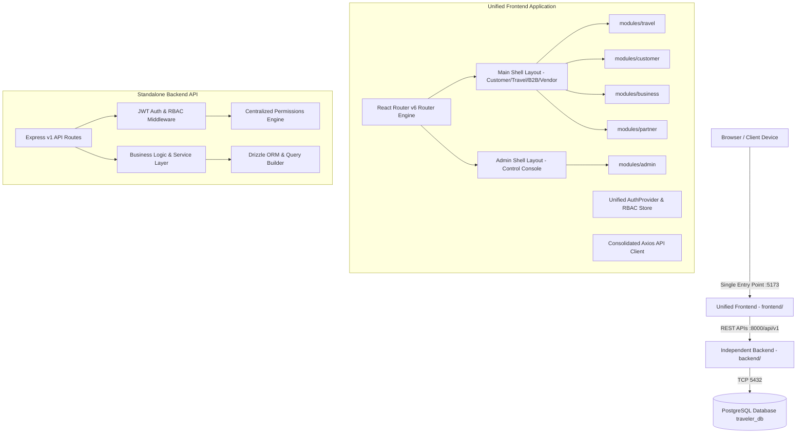
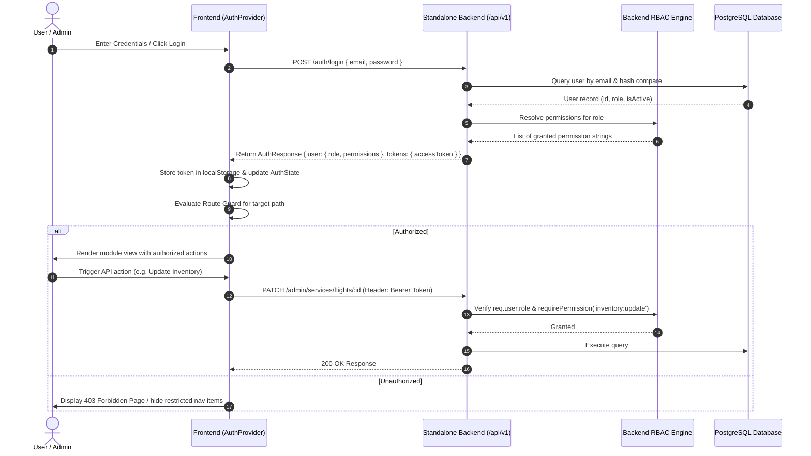

# SyoloTrip Unified System Architecture

## 1. High-Level System Architecture

SyoloTrip is structured into two completely independent, decoupled, and production-ready applications:
1. **Unified Frontend Application (`frontend/`)**: Single-page application built on React 18, Vite, React Router v6, Tailwind CSS, TanStack Query, and Zustand. All end-user travel discovery, customer portal, B2B corporate (myBiz), partner extranet, and administrative control centers run within this single shell.
2. **Standalone Independent Backend (`backend/`)**: High-performance RESTful API service built on Node.js, Express, TypeScript, PostgreSQL (via Drizzle ORM), JWT authentication, and a centralized Role-Based Access Control (RBAC) engine.



---

## 2. Unified Frontend Architecture (`frontend/`)

The unified frontend eliminates fragmented applications by providing:
- **One Package & Entry Point**: Single `package.json`, single Vite configuration (`vite.config.ts`), and single entry script (`src/main.tsx`).
- **Unified Application Providers**: `AppProviders` encapsulates:
  - `QueryClientProvider` (TanStack Query for server cache and data fetching)
  - `ThemeProvider` (Persistent dark / light theme management)
  - `AuthProvider` (Single source of truth for session tokens, roles, and granular permissions)
  - `CurrencyProvider` (Multi-currency live exchange rates: INR, USD, EUR, GBP, AED, SGD)
  - `WishlistProvider` (Synchronized wishlist and saved experiences)
- **Centralized Routing & Protected Routes**: React Router v6 with declarative `ProtectedRoute` guards checking both role membership and granular permission requirements before rendering child modules.
- **Adaptive Application Layouts**:
  - `MainLayout`: Customer header with dynamic context-aware auth actions, currency picker, cart/wishlist modals, and unified footer.
  - `AdminLayout`: Professional admin sidebar, theme switcher, environment status, and breadcrumbs.

### Frontend Directory Structure
```
frontend/
├── public/                 # Static branding emblems, logos, and hero imagery
├── src/
│   ├── app/
│   │   ├── layouts/        # MainLayout and AdminLayout shells
│   │   ├── providers/      # AppProviders and AuthProvider
│   │   └── router/         # React Router v6 router & ProtectedRoute
│   ├── modules/
│   │   ├── travel/         # Flights, Hotels, Trains, Buses, Cabs, Packages, Checkout
│   │   ├── customer/       # Dashboard, My Trips, Saved Travellers, Dual Wallet
│   │   ├── business/       # myBiz Corporate Portal, Employee Travel, Invoices
│   │   ├── partner/        # Extranet, Property Listing, KYC Onboarding
│   │   └── admin/          # 10 Services, Inventory, Pricing, Coupons, Users, Roles
│   ├── components/
│   │   ├── navigation/     # Header, Footer, AdminHeader, AdminSidebar
│   │   └── ui/             # AuthModal, WishlistModal, ForbiddenPage, NotFoundPage
│   ├── contexts/           # ThemeContext, CurrencyContext, WishlistContext
│   ├── hooks/              # useAuth, useRBAC, useTheme, useCurrency, useWishlist
│   ├── services/           # Consolidated api.ts client with Bearer interceptors
│   ├── utils/              # routeContext.ts path normalizers and matchers
│   ├── App.tsx             # Root component wrapping AppProviders & Router
│   ├── main.tsx            # DOM mount point
│   └── index.css           # Consolidated Tailwind layers and custom styling
├── index.html
├── package.json
├── tailwind.config.js
├── tsconfig.json
└── vite.config.ts
```

---

## 3. Standalone Backend Architecture (`backend/`)

The backend is fully self-contained and operates independently of any specific frontend deployment:
- **Modular Route Structure (`app/api/`)**: Domain controllers for auth, travel searches, customer profiles, wallet operations, partner onboarding, myBiz corporate travel, and admin management.
- **Centralized Security Layer (`app/permissions/rbac.ts`)**: Pure TypeScript permission matrix associating platform roles with granular action permissions.
- **Database & Migration Layer (`app/database/`)**: Drizzle ORM schema defining relational tables for users, bookings, inventory, dual wallets, partners, and corporate accounts.
- **Master Workbook Reference Ingestion (`app/database/ingestReferenceData.ts`)**: Automated ingestion of holiday packages from clean Excel workbooks (`data/SS_Journey_Cleaned_Holiday_Packages.xlsx`).

### Backend Directory Structure
```
backend/
├── app/
│   ├── api/                # Express route controllers (/auth, /admin, /wallet, etc.)
│   ├── core/               # Environment config, JWT secrets, and port bindings
│   ├── database/           # Drizzle ORM schema, connection pool, migrations
│   ├── middleware/         # Auth verification and permission enforcement
│   ├── permissions/        # Centralized RBAC definition matrix
│   ├── services/           # Business logic and domain services
│   ├── contracts/          # Self-contained shared TypeScript interfaces
│   ├── index.ts            # Express server initialization
│   └── seed.ts             # Database seeder and administrator bootstrap
├── data/                   # Master reference datasets (Excel workbooks)
├── tests/                  # Node.js native test suites
├── package.json
├── tsconfig.json
└── .env.example
```

---

## 4. End-to-End Authentication & Authorization Flow



